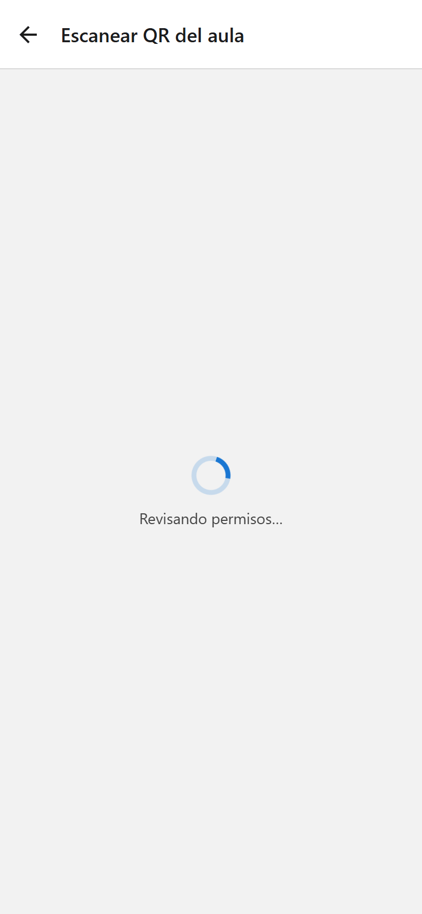

<h1 style="font-family: 'Times New Roman', Times, serif; color: #000000; font-size: 16pt;">Mantenimiento IPF — Trabajo Práctico N° 3: Permisos móviles</h1>

<ul style="font-family: 'Times New Roman', Times, serif; color: #000000; font-size: 12pt;">
<li style="font-family: 'Times New Roman', Times, serif; color: #000000; font-size: 12pt;"><strong style="font-family: 'Times New Roman', Times, serif; color: #000000;">Alumno:</strong> Martinez Javier Nicolás</li>
<li style="font-family: 'Times New Roman', Times, serif; color: #000000; font-size: 12pt;"><strong style="font-family: 'Times New Roman', Times, serif; color: #000000;">Docente a cargo:</strong> Rolón Lautaro Emanuel</li>
<li style="font-family: 'Times New Roman', Times, serif; color: #000000; font-size: 12pt;"><strong style="font-family: 'Times New Roman', Times, serif; color: #000000;">Docente auxiliar:</strong> Mereles Juliana Aracelli</li>
<li style="font-family: 'Times New Roman', Times, serif; color: #000000; font-size: 12pt;"><strong style="font-family: 'Times New Roman', Times, serif; color: #000000;">Materia:</strong> Taller de Lenguajes de Programación III - React Native</li>
<li style="font-family: 'Times New Roman', Times, serif; color: #000000; font-size: 12pt;"><strong style="font-family: 'Times New Roman', Times, serif; color: #000000;">Institución:</strong> Instituto Politécnico Formosa · Tecnicatura Superior en Desarrollo de Software Multiplataforma</li>
</ul>

<h2 style="font-family: 'Times New Roman', Times, serif; color: #000000; font-size: 14pt;">Descripción</h2>

Mantenimiento IPF es una app para que alumnos y docentes reporten desperfectos del edificio (una luz quemada, una canilla que pierde, un proyector roto) y reciban un aviso cuando se resuelven. Está hecha con Expo SDK 57, Expo Router y TypeScript, y aplica la teoría de permisos móviles: cada permiso se pide en el momento justo, después de una pantalla previa, y cada función tiene un camino alternativo si la persona dice que no.

Las respuestas teóricas de las Partes A a F están en el archivo RESPUESTAS.md.

<h2 style="font-family: 'Times New Roman', Times, serif; color: #000000; font-size: 14pt;">Cómo ejecutar el proyecto</h2>

<pre style="font-family: 'Times New Roman', Times, serif; color: #000000; font-size: 12pt;"><code style="font-family: 'Times New Roman', Times, serif; color: #000000; font-size: 12pt;" class="language-bash">npm install
npx expo start          # probar en Expo Go
npx expo run:android    # development build en Android (requiere Android Studio)
</code></pre>

<h2 style="font-family: 'Times New Roman', Times, serif; color: #000000; font-size: 14pt;">Árbol de carpetas de src/app</h2>

<pre style="font-family: 'Times New Roman', Times, serif; color: #000000; font-size: 12pt;"><code style="font-family: 'Times New Roman', Times, serif; color: #000000; font-size: 12pt;" class="language-text">src/
├── app/
│   ├── _layout.tsx             → Stack principal (registra el modal de permisos)
│   ├── (tabs)/
│   │   ├── _layout.tsx         → Tabs: Reportes, Avisos, Permisos
│   │   ├── index.tsx           → /            (lista de reportes)
│   │   ├── avisos.tsx          → /avisos      (bandeja de avisos)
│   │   └── permisos.tsx        → /permisos    (panel de permisos)
│   ├── reporte/
│   │   ├── nuevo.tsx           → /reporte/nuevo
│   │   ├── escanear.tsx        → /reporte/escanear
│   │   ├── foto.tsx            → /reporte/foto
│   │   ├── ubicacion.tsx       → /reporte/ubicacion
│   │   └── [id].tsx            → /reporte/[id]
│   ├── permisos/
│   │   └── [recurso].tsx       → /permisos/[recurso]  (modal, pantalla previa)
│   └── ajustes-app.tsx         → /ajustes-app
├── components/                 → Boton, Cargando, Explicacion, Opciones, estilos
├── hooks/
│   └── usePermiso.ts           → hook unificado de permisos
└── lib/
    ├── permisos.ts             → consultar / pedir permisos y calcular el estado
    ├── notificaciones.ts       → handler y notificación local a los 10 segundos
    └── reportes.tsx            → datos de la app (Context de React)
</code></pre>

La carpeta <code style="font-family: 'Times New Roman', Times, serif; color: #000000; font-size: 12pt;">(tabs)</code> es un grupo: no agrega nada a la URL, solo agrupa las tres pestañas. Por eso <code style="font-family: 'Times New Roman', Times, serif; color: #000000; font-size: 12pt;">(tabs)/index.tsx</code> responde a <code style="font-family: 'Times New Roman', Times, serif; color: #000000; font-size: 12pt;">/</code> y <code style="font-family: 'Times New Roman', Times, serif; color: #000000; font-size: 12pt;">(tabs)/permisos.tsx</code> a <code style="font-family: 'Times New Roman', Times, serif; color: #000000; font-size: 12pt;">/permisos</code>.

<h2 style="font-family: 'Times New Roman', Times, serif; color: #000000; font-size: 14pt;">Bloque plugins de app.json (comentado)</h2>

JSON no admite comentarios, así que el archivo real no los tiene; acá se muestra el mismo bloque explicado.

<pre style="font-family: 'Times New Roman', Times, serif; color: #000000; font-size: 12pt;"><code style="font-family: 'Times New Roman', Times, serif; color: #000000; font-size: 12pt;" class="language-jsonc">&quot;plugins&quot;: [
  &quot;expo-router&quot;,                       // rutas basadas en archivos (src/app)
  [&quot;expo-splash-screen&quot;, { ... }],     // pantalla de carga (plantilla de Expo)
  [
    &quot;expo-camera&quot;,
    {
      // Texto de propósito de iOS (NSCameraUsageDescription)
      &quot;cameraPermission&quot;: &quot;Usamos tu cámara para leer el QR de la puerta del aula y sacar la foto del desperfecto que querés reportar.&quot;,
      &quot;microphonePermission&quot;: false,   // no grabamos video con sonido: sin texto de micrófono en iOS
      &quot;recordAudioAndroid&quot;: false      // y sin RECORD_AUDIO en Android
    }
  ],
  [
    &quot;expo-image-picker&quot;,
    {
      &quot;photosPermission&quot;: false,       // elegimos fotos con el selector del sistema: no pedimos galería
      &quot;cameraPermission&quot;: &quot;Usamos tu cámara para leer el QR de la puerta del aula y sacar la foto del desperfecto que querés reportar.&quot;,
      &quot;microphonePermission&quot;: false    // tampoco grabamos video con este módulo
    }
  ],
  [
    &quot;expo-location&quot;,
    {
      // Solo primer plano (NSLocationWhenInUseUsageDescription)
      &quot;locationWhenInUsePermission&quot;: &quot;Usamos tu ubicación para marcar en qué parte del Instituto está el desperfecto que reportás.&quot;,
      &quot;locationAlwaysAndWhenInUsePermission&quot;: false, // no usamos segundo plano
      &quot;locationAlwaysPermission&quot;: false,             // no usamos segundo plano
      &quot;motionUsagePermission&quot;: false                 // no usamos el sensor de movimiento
    }
  ],
  [
    &quot;expo-notifications&quot;,
    {
      &quot;color&quot;: &quot;#1d4ed8&quot;               // color del ícono de la notificación en Android
      // Las notificaciones no llevan texto de propósito en iOS
    }
  ]
]
</code></pre>

<h2 style="font-family: 'Times New Roman', Times, serif; color: #000000; font-size: 14pt;">Permisos bloqueados (android.blockedPermissions)</h2>

Aplicando el mínimo privilegio, quito con <code style="font-family: 'Times New Roman', Times, serif; color: #000000; font-size: 12pt;">blockedPermissions</code> los permisos que agregan las librerías o la plantilla y que la app no usa:

<table style="font-family: 'Times New Roman', Times, serif; color: #000000; font-size: 12pt; border-collapse: collapse;">
<thead>
<tr>
<th style="font-family: 'Times New Roman', Times, serif; color: #000000; font-size: 12pt; border: 1px solid #000000; padding: 4px;">Permiso bloqueado</th>
<th style="font-family: 'Times New Roman', Times, serif; color: #000000; font-size: 12pt; border: 1px solid #000000; padding: 4px;">Por qué lo quito</th>
</tr>
</thead>
<tbody>
<tr>
<td style="font-family: 'Times New Roman', Times, serif; color: #000000; font-size: 12pt; border: 1px solid #000000; padding: 4px;">RECORD_AUDIO</td>
<td style="font-family: 'Times New Roman', Times, serif; color: #000000; font-size: 12pt; border: 1px solid #000000; padding: 4px;">La app no graba audio ni video con sonido (escanear un QR y sacar una foto no lo necesitan).</td>
</tr>
<tr>
<td style="font-family: 'Times New Roman', Times, serif; color: #000000; font-size: 12pt; border: 1px solid #000000; padding: 4px;">ACCESS_BACKGROUND_LOCATION</td>
<td style="font-family: 'Times New Roman', Times, serif; color: #000000; font-size: 12pt; border: 1px solid #000000; padding: 4px;">La ubicación solo se usa en primer plano, mientras se carga el reporte.</td>
</tr>
<tr>
<td style="font-family: 'Times New Roman', Times, serif; color: #000000; font-size: 12pt; border: 1px solid #000000; padding: 4px;">READ_MEDIA_IMAGES</td>
<td style="font-family: 'Times New Roman', Times, serif; color: #000000; font-size: 12pt; border: 1px solid #000000; padding: 4px;">Las fotos se eligen con el selector del sistema, que no requiere permiso.</td>
</tr>
<tr>
<td style="font-family: 'Times New Roman', Times, serif; color: #000000; font-size: 12pt; border: 1px solid #000000; padding: 4px;">READ_MEDIA_VIDEO</td>
<td style="font-family: 'Times New Roman', Times, serif; color: #000000; font-size: 12pt; border: 1px solid #000000; padding: 4px;">La app no trabaja con videos.</td>
</tr>
<tr>
<td style="font-family: 'Times New Roman', Times, serif; color: #000000; font-size: 12pt; border: 1px solid #000000; padding: 4px;">READ_MEDIA_AUDIO</td>
<td style="font-family: 'Times New Roman', Times, serif; color: #000000; font-size: 12pt; border: 1px solid #000000; padding: 4px;">La app no lee archivos de audio.</td>
</tr>
<tr>
<td style="font-family: 'Times New Roman', Times, serif; color: #000000; font-size: 12pt; border: 1px solid #000000; padding: 4px;">READ_EXTERNAL_STORAGE</td>
<td style="font-family: 'Times New Roman', Times, serif; color: #000000; font-size: 12pt; border: 1px solid #000000; padding: 4px;">Lo agregan expo-image-picker y expo-file-system (hasta API 32); el selector no lo necesita.</td>
</tr>
<tr>
<td style="font-family: 'Times New Roman', Times, serif; color: #000000; font-size: 12pt; border: 1px solid #000000; padding: 4px;">WRITE_EXTERNAL_STORAGE</td>
<td style="font-family: 'Times New Roman', Times, serif; color: #000000; font-size: 12pt; border: 1px solid #000000; padding: 4px;">La app no guarda archivos en el almacenamiento compartido.</td>
</tr>
<tr>
<td style="font-family: 'Times New Roman', Times, serif; color: #000000; font-size: 12pt; border: 1px solid #000000; padding: 4px;">SYSTEM_ALERT_WINDOW</td>
<td style="font-family: 'Times New Roman', Times, serif; color: #000000; font-size: 12pt; border: 1px solid #000000; padding: 4px;">La app no dibuja ventanas encima de otras apps.</td>
</tr>
</tbody>
</table>

<h2 style="font-family: 'Times New Roman', Times, serif; color: #000000; font-size: 14pt;">Tabla de permisos</h2>

<table style="font-family: 'Times New Roman', Times, serif; color: #000000; font-size: 12pt; border-collapse: collapse;">
<thead>
<tr>
<th style="font-family: 'Times New Roman', Times, serif; color: #000000; font-size: 12pt; border: 1px solid #000000; padding: 4px;">Recurso</th>
<th style="font-family: 'Times New Roman', Times, serif; color: #000000; font-size: 12pt; border: 1px solid #000000; padding: 4px;">Módulo</th>
<th style="font-family: 'Times New Roman', Times, serif; color: #000000; font-size: 12pt; border: 1px solid #000000; padding: 4px;">Cuándo se pide</th>
<th style="font-family: 'Times New Roman', Times, serif; color: #000000; font-size: 12pt; border: 1px solid #000000; padding: 4px;">Alternativa si se deniega</th>
</tr>
</thead>
<tbody>
<tr>
<td style="font-family: 'Times New Roman', Times, serif; color: #000000; font-size: 12pt; border: 1px solid #000000; padding: 4px;">Cámara (escanear QR)</td>
<td style="font-family: 'Times New Roman', Times, serif; color: #000000; font-size: 12pt; border: 1px solid #000000; padding: 4px;">expo-camera</td>
<td style="font-family: 'Times New Roman', Times, serif; color: #000000; font-size: 12pt; border: 1px solid #000000; padding: 4px;">Al tocar "Escanear QR del aula" y después "Usar la cámara", pasando por la pantalla previa.</td>
<td style="font-family: 'Times New Roman', Times, serif; color: #000000; font-size: 12pt; border: 1px solid #000000; padding: 4px;">Escribir el código del aula a mano.</td>
</tr>
<tr>
<td style="font-family: 'Times New Roman', Times, serif; color: #000000; font-size: 12pt; border: 1px solid #000000; padding: 4px;">Cámara (sacar foto)</td>
<td style="font-family: 'Times New Roman', Times, serif; color: #000000; font-size: 12pt; border: 1px solid #000000; padding: 4px;">expo-image-picker (<code style="font-family: 'Times New Roman', Times, serif; color: #000000; font-size: 12pt;">launchCameraAsync</code>)</td>
<td style="font-family: 'Times New Roman', Times, serif; color: #000000; font-size: 12pt; border: 1px solid #000000; padding: 4px;">Al tocar "Sacar foto", pasando por la pantalla previa.</td>
<td style="font-family: 'Times New Roman', Times, serif; color: #000000; font-size: 12pt; border: 1px solid #000000; padding: 4px;">Elegir la foto desde la galería con el selector del sistema.</td>
</tr>
<tr>
<td style="font-family: 'Times New Roman', Times, serif; color: #000000; font-size: 12pt; border: 1px solid #000000; padding: 4px;">Fotos (galería)</td>
<td style="font-family: 'Times New Roman', Times, serif; color: #000000; font-size: 12pt; border: 1px solid #000000; padding: 4px;">expo-image-picker (<code style="font-family: 'Times New Roman', Times, serif; color: #000000; font-size: 12pt;">launchImageLibraryAsync</code>)</td>
<td style="font-family: 'Times New Roman', Times, serif; color: #000000; font-size: 12pt; border: 1px solid #000000; padding: 4px;">Nunca: el selector del sistema no requiere permiso.</td>
<td style="font-family: 'Times New Roman', Times, serif; color: #000000; font-size: 12pt; border: 1px solid #000000; padding: 4px;">No hace falta.</td>
</tr>
<tr>
<td style="font-family: 'Times New Roman', Times, serif; color: #000000; font-size: 12pt; border: 1px solid #000000; padding: 4px;">Ubicación (primer plano)</td>
<td style="font-family: 'Times New Roman', Times, serif; color: #000000; font-size: 12pt; border: 1px solid #000000; padding: 4px;">expo-location</td>
<td style="font-family: 'Times New Roman', Times, serif; color: #000000; font-size: 12pt; border: 1px solid #000000; padding: 4px;">Al tocar "Usar mi ubicación", pasando por la pantalla previa.</td>
<td style="font-family: 'Times New Roman', Times, serif; color: #000000; font-size: 12pt; border: 1px solid #000000; padding: 4px;">Elegir el sector a mano (patio, estacionamiento, pasillo…).</td>
</tr>
<tr>
<td style="font-family: 'Times New Roman', Times, serif; color: #000000; font-size: 12pt; border: 1px solid #000000; padding: 4px;">Notificaciones</td>
<td style="font-family: 'Times New Roman', Times, serif; color: #000000; font-size: 12pt; border: 1px solid #000000; padding: 4px;">expo-notifications</td>
<td style="font-family: 'Times New Roman', Times, serif; color: #000000; font-size: 12pt; border: 1px solid #000000; padding: 4px;">Al activar el interruptor "Avisarme cuando se resuelva mi reporte" en /ajustes-app (en Android se crea antes el canal "reportes").</td>
<td style="font-family: 'Times New Roman', Times, serif; color: #000000; font-size: 12pt; border: 1px solid #000000; padding: 4px;">Bandeja de avisos dentro de la app (/avisos).</td>
</tr>
</tbody>
</table>

<h2 style="font-family: 'Times New Roman', Times, serif; color: #000000; font-size: 14pt;">Cómo funciona el hook usePermiso</h2>

<code style="font-family: 'Times New Roman', Times, serif; color: #000000; font-size: 12pt;">usePermiso(recurso)</code> (en <code style="font-family: 'Times New Roman', Times, serif; color: #000000; font-size: 12pt;">src/hooks/usePermiso.ts</code>) devuelve:

<ul style="font-family: 'Times New Roman', Times, serif; color: #000000; font-size: 12pt;">
<li style="font-family: 'Times New Roman', Times, serif; color: #000000; font-size: 12pt;"><strong style="font-family: 'Times New Roman', Times, serif; color: #000000;">estado:</strong> <code style="font-family: 'Times New Roman', Times, serif; color: #000000; font-size: 12pt;">'cargando'</code> (todavía no hay respuesta), <code style="font-family: 'Times New Roman', Times, serif; color: #000000; font-size: 12pt;">'concedido'</code> (<code style="font-family: 'Times New Roman', Times, serif; color: #000000; font-size: 12pt;">granted</code>), <code style="font-family: 'Times New Roman', Times, serif; color: #000000; font-size: 12pt;">'preguntable'</code> (<code style="font-family: 'Times New Roman', Times, serif; color: #000000; font-size: 12pt;">canAskAgain: true</code>) o <code style="font-family: 'Times New Roman', Times, serif; color: #000000; font-size: 12pt;">'bloqueado'</code> (<code style="font-family: 'Times New Roman', Times, serif; color: #000000; font-size: 12pt;">canAskAgain: false</code>).</li>
<li style="font-family: 'Times New Roman', Times, serif; color: #000000; font-size: 12pt;"><strong style="font-family: 'Times New Roman', Times, serif; color: #000000;">parcial:</strong> <code style="font-family: 'Times New Roman', Times, serif; color: #000000; font-size: 12pt;">true</code> si la ubicación es aproximada (<code style="font-family: 'Times New Roman', Times, serif; color: #000000; font-size: 12pt;">android.accuracy === 'coarse'</code> o <code style="font-family: 'Times New Roman', Times, serif; color: #000000; font-size: 12pt;">ios.accuracy === 'reduced'</code>) o si las notificaciones de iOS son provisionales.</li>
<li style="font-family: 'Times New Roman', Times, serif; color: #000000; font-size: 12pt;"><strong style="font-family: 'Times New Roman', Times, serif; color: #000000;">pedir():</strong> muestra el diálogo del sistema; solo se llama desde el botón "Continuar" de la pantalla previa.</li>
<li style="font-family: 'Times New Roman', Times, serif; color: #000000; font-size: 12pt;"><strong style="font-family: 'Times New Roman', Times, serif; color: #000000;">abrirAjustes():</strong> abre la pantalla de la app en Ajustes con <code style="font-family: 'Times New Roman', Times, serif; color: #000000; font-size: 12pt;">Linking.openSettings()</code>.</li>
</ul>

El hook vuelve a consultar el permiso cuando la pantalla recibe el foco y cuando la app pasa de segundo plano a <code style="font-family: 'Times New Roman', Times, serif; color: #000000; font-size: 12pt;">active</code> (escucha <code style="font-family: 'Times New Roman', Times, serif; color: #000000; font-size: 12pt;">AppState</code>), por eso el panel de permisos se actualiza solo al volver de Ajustes.

<h2 style="font-family: 'Times New Roman', Times, serif; color: #000000; font-size: 14pt;">Auditoría del manifiesto (desafío opcional)</h2>

Resultado de <code style="font-family: 'Times New Roman', Times, serif; color: #000000; font-size: 12pt;">npx expo prebuild --clean</code> y de la fusión de manifiestos de las librerías:

<table style="font-family: 'Times New Roman', Times, serif; color: #000000; font-size: 12pt; border-collapse: collapse;">
<thead>
<tr>
<th style="font-family: 'Times New Roman', Times, serif; color: #000000; font-size: 12pt; border: 1px solid #000000; padding: 4px;">Permiso</th>
<th style="font-family: 'Times New Roman', Times, serif; color: #000000; font-size: 12pt; border: 1px solid #000000; padding: 4px;">Quién lo agrega</th>
<th style="font-family: 'Times New Roman', Times, serif; color: #000000; font-size: 12pt; border: 1px solid #000000; padding: 4px;">¿Queda?</th>
</tr>
</thead>
<tbody>
<tr>
<td style="font-family: 'Times New Roman', Times, serif; color: #000000; font-size: 12pt; border: 1px solid #000000; padding: 4px;">INTERNET</td>
<td style="font-family: 'Times New Roman', Times, serif; color: #000000; font-size: 12pt; border: 1px solid #000000; padding: 4px;">Plantilla de Expo / expo-file-system</td>
<td style="font-family: 'Times New Roman', Times, serif; color: #000000; font-size: 12pt; border: 1px solid #000000; padding: 4px;">Sí (normal)</td>
</tr>
<tr>
<td style="font-family: 'Times New Roman', Times, serif; color: #000000; font-size: 12pt; border: 1px solid #000000; padding: 4px;">VIBRATE</td>
<td style="font-family: 'Times New Roman', Times, serif; color: #000000; font-size: 12pt; border: 1px solid #000000; padding: 4px;">Plantilla de Expo</td>
<td style="font-family: 'Times New Roman', Times, serif; color: #000000; font-size: 12pt; border: 1px solid #000000; padding: 4px;">Sí (normal)</td>
</tr>
<tr>
<td style="font-family: 'Times New Roman', Times, serif; color: #000000; font-size: 12pt; border: 1px solid #000000; padding: 4px;">CAMERA</td>
<td style="font-family: 'Times New Roman', Times, serif; color: #000000; font-size: 12pt; border: 1px solid #000000; padding: 4px;">expo-camera y expo-image-picker</td>
<td style="font-family: 'Times New Roman', Times, serif; color: #000000; font-size: 12pt; border: 1px solid #000000; padding: 4px;">Sí</td>
</tr>
<tr>
<td style="font-family: 'Times New Roman', Times, serif; color: #000000; font-size: 12pt; border: 1px solid #000000; padding: 4px;">ACCESS_COARSE_LOCATION</td>
<td style="font-family: 'Times New Roman', Times, serif; color: #000000; font-size: 12pt; border: 1px solid #000000; padding: 4px;">expo-location</td>
<td style="font-family: 'Times New Roman', Times, serif; color: #000000; font-size: 12pt; border: 1px solid #000000; padding: 4px;">Sí</td>
</tr>
<tr>
<td style="font-family: 'Times New Roman', Times, serif; color: #000000; font-size: 12pt; border: 1px solid #000000; padding: 4px;">ACCESS_FINE_LOCATION</td>
<td style="font-family: 'Times New Roman', Times, serif; color: #000000; font-size: 12pt; border: 1px solid #000000; padding: 4px;">expo-location</td>
<td style="font-family: 'Times New Roman', Times, serif; color: #000000; font-size: 12pt; border: 1px solid #000000; padding: 4px;">Sí</td>
</tr>
<tr>
<td style="font-family: 'Times New Roman', Times, serif; color: #000000; font-size: 12pt; border: 1px solid #000000; padding: 4px;">POST_NOTIFICATIONS</td>
<td style="font-family: 'Times New Roman', Times, serif; color: #000000; font-size: 12pt; border: 1px solid #000000; padding: 4px;">expo-notifications</td>
<td style="font-family: 'Times New Roman', Times, serif; color: #000000; font-size: 12pt; border: 1px solid #000000; padding: 4px;">Sí</td>
</tr>
<tr>
<td style="font-family: 'Times New Roman', Times, serif; color: #000000; font-size: 12pt; border: 1px solid #000000; padding: 4px;">RECEIVE_BOOT_COMPLETED</td>
<td style="font-family: 'Times New Roman', Times, serif; color: #000000; font-size: 12pt; border: 1px solid #000000; padding: 4px;">expo-notifications</td>
<td style="font-family: 'Times New Roman', Times, serif; color: #000000; font-size: 12pt; border: 1px solid #000000; padding: 4px;">Sí (normal, para reprogramar notificaciones al reiniciar)</td>
</tr>
<tr>
<td style="font-family: 'Times New Roman', Times, serif; color: #000000; font-size: 12pt; border: 1px solid #000000; padding: 4px;">RECORD_AUDIO</td>
<td style="font-family: 'Times New Roman', Times, serif; color: #000000; font-size: 12pt; border: 1px solid #000000; padding: 4px;">expo-camera / expo-image-picker</td>
<td style="font-family: 'Times New Roman', Times, serif; color: #000000; font-size: 12pt; border: 1px solid #000000; padding: 4px;">No, lo quité</td>
</tr>
<tr>
<td style="font-family: 'Times New Roman', Times, serif; color: #000000; font-size: 12pt; border: 1px solid #000000; padding: 4px;">READ_EXTERNAL_STORAGE</td>
<td style="font-family: 'Times New Roman', Times, serif; color: #000000; font-size: 12pt; border: 1px solid #000000; padding: 4px;">expo-image-picker / expo-file-system / plantilla</td>
<td style="font-family: 'Times New Roman', Times, serif; color: #000000; font-size: 12pt; border: 1px solid #000000; padding: 4px;">No, lo quité</td>
</tr>
<tr>
<td style="font-family: 'Times New Roman', Times, serif; color: #000000; font-size: 12pt; border: 1px solid #000000; padding: 4px;">WRITE_EXTERNAL_STORAGE</td>
<td style="font-family: 'Times New Roman', Times, serif; color: #000000; font-size: 12pt; border: 1px solid #000000; padding: 4px;">expo-image-picker / expo-file-system / plantilla</td>
<td style="font-family: 'Times New Roman', Times, serif; color: #000000; font-size: 12pt; border: 1px solid #000000; padding: 4px;">No, lo quité</td>
</tr>
<tr>
<td style="font-family: 'Times New Roman', Times, serif; color: #000000; font-size: 12pt; border: 1px solid #000000; padding: 4px;">SYSTEM_ALERT_WINDOW</td>
<td style="font-family: 'Times New Roman', Times, serif; color: #000000; font-size: 12pt; border: 1px solid #000000; padding: 4px;">Plantilla de Expo</td>
<td style="font-family: 'Times New Roman', Times, serif; color: #000000; font-size: 12pt; border: 1px solid #000000; padding: 4px;">No, lo quité</td>
</tr>
<tr>
<td style="font-family: 'Times New Roman', Times, serif; color: #000000; font-size: 12pt; border: 1px solid #000000; padding: 4px;">ACCESS_BACKGROUND_LOCATION, READ_MEDIA_*</td>
<td style="font-family: 'Times New Roman', Times, serif; color: #000000; font-size: 12pt; border: 1px solid #000000; padding: 4px;">Prevención (ninguna librería debe agregarlos)</td>
<td style="font-family: 'Times New Roman', Times, serif; color: #000000; font-size: 12pt; border: 1px solid #000000; padding: 4px;">No, bloqueados</td>
</tr>
</tbody>
</table>

<h2 style="font-family: 'Times New Roman', Times, serif; color: #000000; font-size: 14pt;">Capturas y video</h2>

<!-- Reemplazar cada línea por la imagen correspondiente, por ejemplo:  -->

<table style="font-family: 'Times New Roman', Times, serif; color: #000000; font-size: 12pt; border-collapse: collapse;">
<thead>
<tr>
<th style="font-family: 'Times New Roman', Times, serif; color: #000000; font-size: 12pt; border: 1px solid #000000; padding: 4px;">Caso</th>
<th style="font-family: 'Times New Roman', Times, serif; color: #000000; font-size: 12pt; border: 1px solid #000000; padding: 4px;">Captura</th>
</tr>
</thead>
<tbody>
<tr>
<td style="font-family: 'Times New Roman', Times, serif; color: #000000; font-size: 12pt; border: 1px solid #000000; padding: 4px;">Escáner · cargando</td>
<td style="font-family: 'Times New Roman', Times, serif; color: #000000; font-size: 12pt; border: 1px solid #000000; padding: 4px;">(insertar captura)</td>
</tr>
<tr>
<td style="font-family: 'Times New Roman', Times, serif; color: #000000; font-size: 12pt; border: 1px solid #000000; padding: 4px;">Escáner · concedido (cámara)</td>
<td style="font-family: 'Times New Roman', Times, serif; color: #000000; font-size: 12pt; border: 1px solid #000000; padding: 4px;">(insertar captura)</td>
</tr>
<tr>
<td style="font-family: 'Times New Roman', Times, serif; color: #000000; font-size: 12pt; border: 1px solid #000000; padding: 4px;">Escáner · preguntable</td>
<td style="font-family: 'Times New Roman', Times, serif; color: #000000; font-size: 12pt; border: 1px solid #000000; padding: 4px;">(insertar captura)</td>
</tr>
<tr>
<td style="font-family: 'Times New Roman', Times, serif; color: #000000; font-size: 12pt; border: 1px solid #000000; padding: 4px;">Escáner · bloqueado</td>
<td style="font-family: 'Times New Roman', Times, serif; color: #000000; font-size: 12pt; border: 1px solid #000000; padding: 4px;">(insertar captura)</td>
</tr>
<tr>
<td style="font-family: 'Times New Roman', Times, serif; color: #000000; font-size: 12pt; border: 1px solid #000000; padding: 4px;">Ubicación concedida</td>
<td style="font-family: 'Times New Roman', Times, serif; color: #000000; font-size: 12pt; border: 1px solid #000000; padding: 4px;">(insertar captura)</td>
</tr>
<tr>
<td style="font-family: 'Times New Roman', Times, serif; color: #000000; font-size: 12pt; border: 1px solid #000000; padding: 4px;">Ubicación denegada (sector a mano)</td>
<td style="font-family: 'Times New Roman', Times, serif; color: #000000; font-size: 12pt; border: 1px solid #000000; padding: 4px;">(insertar captura)</td>
</tr>
<tr>
<td style="font-family: 'Times New Roman', Times, serif; color: #000000; font-size: 12pt; border: 1px solid #000000; padding: 4px;">Foto elegida desde el selector</td>
<td style="font-family: 'Times New Roman', Times, serif; color: #000000; font-size: 12pt; border: 1px solid #000000; padding: 4px;">(insertar captura)</td>
</tr>
<tr>
<td style="font-family: 'Times New Roman', Times, serif; color: #000000; font-size: 12pt; border: 1px solid #000000; padding: 4px;">Notificación recibida</td>
<td style="font-family: 'Times New Roman', Times, serif; color: #000000; font-size: 12pt; border: 1px solid #000000; padding: 4px;">(insertar captura)</td>
</tr>
<tr>
<td style="font-family: 'Times New Roman', Times, serif; color: #000000; font-size: 12pt; border: 1px solid #000000; padding: 4px;">Panel de permisos antes de ir a Ajustes</td>
<td style="font-family: 'Times New Roman', Times, serif; color: #000000; font-size: 12pt; border: 1px solid #000000; padding: 4px;">(insertar captura)</td>
</tr>
<tr>
<td style="font-family: 'Times New Roman', Times, serif; color: #000000; font-size: 12pt; border: 1px solid #000000; padding: 4px;">Panel de permisos después de volver de Ajustes</td>
<td style="font-family: 'Times New Roman', Times, serif; color: #000000; font-size: 12pt; border: 1px solid #000000; padding: 4px;">(insertar captura)</td>
</tr>
<tr>
<td style="font-family: 'Times New Roman', Times, serif; color: #000000; font-size: 12pt; border: 1px solid #000000; padding: 4px;">Diálogo del sistema en la development build (texto de propósito)</td>
<td style="font-family: 'Times New Roman', Times, serif; color: #000000; font-size: 12pt; border: 1px solid #000000; padding: 4px;">(insertar captura)</td>
</tr>
</tbody>
</table>

Video corto (opcional): (insertar enlace)

